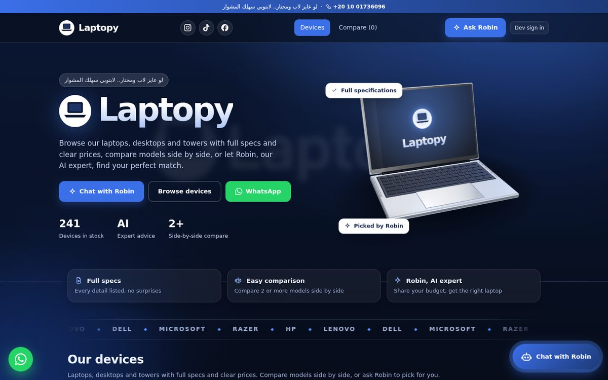

# Laptopy – laptop store website

A complete Node.js project for the **Laptopy** laptop store (Giza, Egypt):

- Catalogue with specs and prices, search, brand filter and a **two-thumb price slider**
- **A page for every laptop**: photo gallery with a full-screen viewer, full grouped specifications, description,
  WhatsApp order button, "ask Robin about it" and similar laptops
- **Excel import**: the admin uploads one sheet with all devices and the website updates for every visitor automatically (your own price-list format works as it is)
- **"View photos"** on every device: opens a Google Images search for its exact, cleaned-up product name
- Laptops, desktops and towers, with filters for type, brand and price, and "Show more" for large catalogues
- **Graphical comparison** of 2-4 laptops (animated bars, overall score, best value highlighted)
- **Robin**, the AI laptop advisor: understands Arabic (Egyptian) and English, recommends only from your real stock
- **Admin panel** (add / edit / hide / delete laptops, change prices) behind **real Google Sign-In**
- WhatsApp ordering, store address with map link, Instagram / TikTok / Facebook links
- A realistic **3D hero laptop** (WebGL / three.js): aluminium body, real keyboard layout, hinge and glass screen under studio lighting.
  The lid opens slowly, the screen lights up the keys, then the logo and store name appear
- Glass-style navy design taken from the logo

> Arabic quick start: see [`README.ar.md`](README.ar.md).



| Laptop page | Photo viewer | Excel import |
|---|---|---|
|  |  |  |

## Quick start

Requires **Node.js 22+**.

```bash
npm install
cp .env.example .env        # then edit .env
npm run dev                 # http://localhost:3000
```

Without any keys the site already works: Robin answers with the built-in advisor and you can try the admin
panel locally with `DEV_AUTH=true` (a "Dev sign in" button appears; sign in as `ramezmilab@gmail.com`).
**Never enable `DEV_AUTH` in production** (the server refuses to start if you do).

### Turn on Google Sign-In (real admin login)

1. Open <https://console.cloud.google.com/apis/credentials> -> **Create credentials -> OAuth client ID** -> *Web application*.
2. Under **Authorized JavaScript origins** add your site (for example `https://laptopy.example.com`)
   and `http://localhost:3000` for testing.
3. Copy the **Client ID** into `.env`:
   ```
   GOOGLE_CLIENT_ID=1234567890-abc.apps.googleusercontent.com
   ADMIN_EMAIL=ramezmilab@gmail.com
   ```
4. Restart. A "Sign in with Google" button appears in the header. Only the account in `ADMIN_EMAIL` sees the **Admin**
   tab and can change laptops. Everyone else (signed out or signed in with another Google account) sees no admin tab,
   and the server rejects their write requests with 401/403.

### Turn on the full AI for Robin (optional)

Put an Anthropic API key in `.env` (`ANTHROPIC_API_KEY=...`). Robin then answers anything the customer writes,
streams the reply and always uses the live stock. If the key is missing or the AI is down, Robin falls back to
the built-in rule-based advisor, so customers always get an answer. The key stays on the server.

## Your catalogue: the 241 devices from the price list

The website starts with the devices of `docs/laptopy_price_list.xlsx` (212 laptops, 22 desktops, 7 towers). They were loaded
by the same reader the Admin "Import from Excel" button uses, so they behave exactly like an import:

- The sheet is typed by hand (`hp840 g8`, `percision 7720`, `P5510`, `razer- 14`, `i5-8th (U)`, `nvidia 4 g`), so names and specs are
  cleaned up: **HP EliteBook 840 G8**, **Dell Precision 7720**, **Dell Precision 5510**, **Razer Blade 14**, **Core i5 8th Gen (U)**,
  **256GB SSD**, **NVIDIA 4GB**... (the rules are in `src/services/price-list.normalizer.js`, with tests).
- HP's real names were checked: the 14-inch ZBook G5 is the **ZBook 14u G5**, and from G7 it is the **ZBook Firefly 14**.
- A plain size in the `SSD | HDD` column is read as **SSD** (`256GB` -> `256GB SSD`); `HDD 500GB` -> `500GB HDD`.
- The same model with different CPU / RAM / storage is a different **variant** (each row is one variant). The device page lists
  "Other versions of this model".
- The same model and specs listed twice with a **different price** (two units from two suppliers) are both kept;
  a repeated row with the **same price** is dropped as a duplicate.
- Desktops and towers have no battery, weight or screen: those fields are simply left out (and never counted as zero in comparisons).
- To rebuild the starting catalogue from a newer sheet: `npm run build:seed` (writes `seed/laptops.seed.json`). It is only used the
  **first time** the website starts; after that the catalogue lives in `data/laptops.json` and is changed from the Admin panel.
  Set `SEED_FILE=path/to/other.json` to start from a different file.

### "View photos"

Every device has a **View photos** button (on the card and on its page) that opens, in a new tab, a Google Images search for the
**exact product name in quotes**, for example `"HP EliteBook 840 G8" laptop` (towers get `tower pc`, desktops `desktop`).
Because the names are cleaned first, the results are pictures of that model and not of a different one.
The searches show pictures of the model, not necessarily of the exact unit or its CPU variant.
Two names could not be identified exactly and are worth a look: **HP 655S** (searched as `HP 655 laptop AMD 15.6`) and **Dell Pro**
(searched as `Dell Pro 14`). To use your own page for a device, fill **Photos link** in Admin -> Edit.

## Adding devices from Excel (admin)

Open **Admin -> Import devices from Excel**.

1. Choose your Excel file. Your own price list works as it is (**Type, Model, CPU, RAM, SSD | HDD, GPU, Display, Price, Photo**),
   or download the template (also available as [`docs/laptopy-laptops-template.xlsx`](docs/laptopy-laptops-template.xlsx)).
2. You first get a **preview** (how many will be added / updated / skipped, and why). Nothing is saved yet.
3. Click **Import now**. Customers see the new catalogue immediately.

| Column | Required | Notes |
|--------|----------|-------|
| Model | yes | In the price-list format the **brand is detected from the model** (HP, Dell, Lenovo, Microsoft, Razer...) |
| Brand | only if there is no way to detect it | add a `Brand` column to use your own brand names |
| Price | yes | `18500`, `18,500` and `١٨٥٠٠` all work |
| CPU, RAM, Storage (`SSD | HDD`) | yes | text, e.g. `16GB`, `512GB SSD` |
| Type | no | `Laptop`, `Desktop` or `Tower` (empty = Laptop) |
| Display / Screen, GPU, Battery, Weight, Notes, Description, OS, Color, Ports, Warranty | no | shown on the device's page |
| Photo / Photos link | no | a hyperlink (like your "View photos") or an `https://` link; empty = automatic exact-name search |
| Images | no | links to picture **files** (`.jpg`, `.png`, `.webp`) separated by a space; empty = keep current photos |
| In stock | no | `yes` / `no` (`نعم` / `لا`). Empty = keep as is; new devices default to yes |

- The header row can be anywhere in the first 20 rows (your sheet has a title above it). Headers may be in **English or Arabic**.
- **How a row finds its device:** if the model appears once in the file and once in the catalogue, by brand + model (so a changed CPU
  or RAM updates it); otherwise by model + CPU + RAM + storage + graphics (+ its line number when the same variant is listed twice).
  Importing the same sheet again changes nothing; changing a price in the sheet updates just that device.
- An **empty cell never erases** existing data. Rows with a problem are **skipped and listed with the row number**; the good rows are imported.
- Tick **"Also remove devices that are not in this file"** to make the website match the sheet exactly (it asks for confirmation).
- Photos can also be uploaded one by one from **Admin -> Edit and photos** (JPG, PNG or WebP, up to 5 MB, 10 per device), stored in
  `DATA_DIR/uploads` (keep `DATA_DIR` on a persistent disk).

## How the admin protection works

1. The browser gets a Google **ID token** and sends it to `POST /api/auth/google`.
2. The server verifies the token with Google's library (signature, expiry, audience = your client id) and requires
   `email_verified`.
3. It sets an **HttpOnly, SameSite=Lax (Secure in production)** session cookie holding a signed JWT.
4. The admin flag is **recomputed from the e-mail on every request** (`ADMIN_EMAIL`), never stored in the token.
5. Every write route runs `requireAdmin`. Hiding the Admin tab in the browser is only cosmetic; the server is the lock.

## Project structure

```
laptopy/
├─ server.js                     # entry point: load config, start listening, graceful shutdown
├─ package.json  .env.example  .nvmrc  .editorconfig  .gitignore
├─ config/store.json             # store name, slogan, phone, WhatsApp, address, social links
├─ seed/laptops.seed.json        # the starting catalogue (241 devices from your price list), copied to data/ on first run
├─ scripts/build-seed.mjs        # rebuilds that catalogue from an Excel price list (npm run build:seed)
├─ data/                         # runtime data (laptops.json, uploads/) – git-ignored, keep on a persistent disk
├─ shared/specs.js               # spec parsing + comparison scoring (used by server AND browser)
├─ src/
│  ├─ app.js                     # builds the Express app (security headers, middleware order, routes)
│  ├─ container.js               # composition root: creates and wires repositories/services/controllers
│  ├─ config/                    # index.js (validated environment), store.js (store.json loader)
│  ├─ routes/                    # URL -> controller mapping only (index, auth, laptops, advisor, config)
│  ├─ controllers/               # HTTP layer: read request, call service, send response
│  ├─ services/                  # business logic (laptop, laptop-image, laptop-import, price-list.normalizer, advisor "Robin", local advisor, session, google-auth)
│  ├─ providers/                 # external APIs (anthropic.provider.js)
│  ├─ prompts/                   # Robin's prompts
│  ├─ repositories/              # persistence (laptop.repository.js, atomic JSON file)
│  ├─ validators/                # zod schemas for every request body
│  ├─ middleware/                # session, auth guards, origin check (CSRF), rate limits, error handler
│  └─ utils/                     # logger, HttpError helpers
├─ public/                       # the website (served as static files)
│  ├─ index.html
│  ├─ css/                       # base, layout, components, laptop3d, motion
│  ├─ js/
│  │  ├─ main.js                 # boot + hash router
│  │  ├─ api.js  state.js  events.js  hooks.js  data.js  auth.js  effects.js  utils.js  icons.js
│  │  ├─ views/                  # header, hero, shop, product (laptop page), compare, admin, visit, footer
│  │  └─ components/             # laptopCard, priceSlider, chat (Robin), laptop3d, social, laptopArt
│  ├─ vendor/laptop-scene.js     # the 3D laptop (built bundle, includes three.js)
│  └─ assets/                    # logo, favicon, laptop-poster.webp (still picture used when WebGL is unavailable)
├─ assets-src/laptop-scene/      # source of the 3D laptop (edit this, then run: npm run build:scene)
├─ docs/                         # design-system.md, screenshots
└─ test/
   ├─ unit/  integration/  support/
```

**Dependency direction:** `routes -> controllers -> services -> repositories/providers`. Controllers never touch files
or APIs directly; services never touch `req`/`res`. Everything is created in `container.js`, so tests can swap
storage, Google and the AI provider for fakes.

## API

| Method & path | Who | Purpose |
|---------------|-----|---------|
| `GET /api/config` | public | store info + feature flags (no secrets) |
| `GET /api/auth/me` | public | current user or `null` |
| `POST /api/auth/google` | public | exchange a Google ID token for a session |
| `POST /api/auth/logout` | public | clear the session |
| `GET /api/laptops` | public | catalogue (`?all=1` only honoured for the admin) |
| `GET /api/laptops/:id` | public | one laptop |
| `POST /api/laptops` | **admin** | add a laptop |
| `GET /api/laptops/template.xlsx` | **admin** | download the Excel template |
| `POST /api/laptops/import?dryRun=1&replace=1` | **admin** | import an `.xlsx` / `.csv` sent as the raw body (`dryRun=1` = preview only) |
| `POST /api/laptops/:id/images` | **admin** | upload one photo (raw JPG/PNG/WebP body) |
| `DELETE /api/laptops/:id/images/:index` | **admin** | remove a photo |
| `PATCH /api/laptops/:id` | **admin** | change any fields (price, stock...) |
| `DELETE /api/laptops/:id` | **admin** | delete |
| `POST /api/chat` | public, rate-limited | chat with Robin (Server-Sent Events stream) |
| `POST /api/compare` | public, rate-limited | Robin's comparison verdict for 2-4 laptops |
| `GET /healthz` | public | liveness probe |

Errors are always JSON: `{ "error": { "code", "message", "fields?" } }`.

## Security

- Strict **Content-Security-Policy** (helmet): no inline scripts, no `eval`; only Google Sign-In and Google Fonts are allowed.
- Secrets only in environment variables; `SESSION_SECRET` is mandatory in production.
- Rate limits (chat is the strictest, because it can cost money), body size limit, zod validation on every input.
- CSRF defence: SameSite cookies + `Origin` check on state-changing requests.
- Output is escaped in the browser (`esc()`); Robin's replies are escaped before the small `**bold**` formatting is applied.
- Writes to `laptops.json` are serialised and atomic (temp file + rename).

## The 3D hero laptop

The laptop is modelled entirely in code (`assets-src/laptop-scene/main.js`, three.js): rounded aluminium body, keycaps in a real
keyboard layout, speaker grills, trackpad, hinge, glass-covered screen, studio image-based lighting, light spilling from the
screen onto the keys and a soft ground shadow. The screen shows the logo and the store name (taken from `config/store.json`).

- Edit the scene, then rebuild the single file the website loads: `npm run build:scene` (output: `public/vendor/laptop-scene.js`).
- Timings are in the `T` object at the top of the file (when the lid opens, how long it takes, when the screen lights up).
- It draws only while it is on screen and the tab is visible. With *reduce motion* enabled it shows the finished laptop without movement.
- No WebGL (very old devices) or a loading error: the site shows `public/assets/laptop-poster.webp` instead.
- `/?lapt=4.5` freezes the animation at second 4.5 (used to make screenshots and the poster).

## Tests

```bash
npm test      # 69 tests: auth, admin protection, validation, persistence, Excel import, photo upload, Robin, comparison, server boot
```

The suite uses fake Google and AI providers, so it needs no internet or keys.
The front-end was also checked end-to-end in a headless Chromium (filters, slider, compare, laptop pages and photo viewer, chat, Excel import, photo upload, admin, mobile).

## Deploying

Any Node host works (Render, Railway, Fly.io, a VPS):

- Set `NODE_ENV=production`, `SESSION_SECRET`, `GOOGLE_CLIENT_ID`, `ADMIN_EMAIL` (and `ANTHROPIC_API_KEY`).
- Set `TRUST_PROXY=true` when the platform terminates HTTPS in front of the app.
- Mount a **persistent disk** and point `DATA_DIR` at it (otherwise laptops, imports and uploaded photos are lost on redeploy).
- Add your production URL to the OAuth client's *Authorized JavaScript origins*.
- The JSON-file storage is meant for one server instance. To scale out, replace `laptop.repository.js`
  with a database-backed class that has the same methods (nothing else changes).

## Changing store details

Edit `config/store.json` (name, slogan, phone, WhatsApp number with country code and no `+`, address, social links)
and restart. Laptops are managed from the Admin tab, not from files.

## Credits

- Hero laptop idea: "Animated 3D MacBook Air" by @jahed on 21st.dev (the model and animation here are written from scratch).
- 3D engine: [three.js](https://threejs.org) (MIT). Brand icons: [Simple Icons](https://simpleicons.org) (CC0).
- Accessibility and UX checklist: the ui-ux-pro-max skill (see `docs/design-system.md`).
